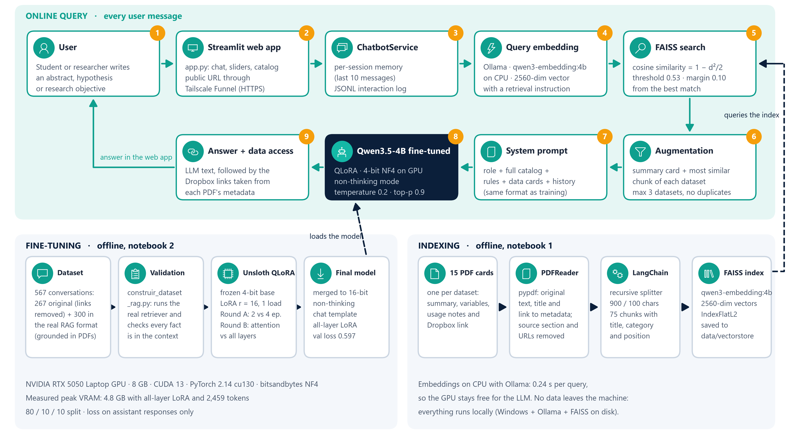
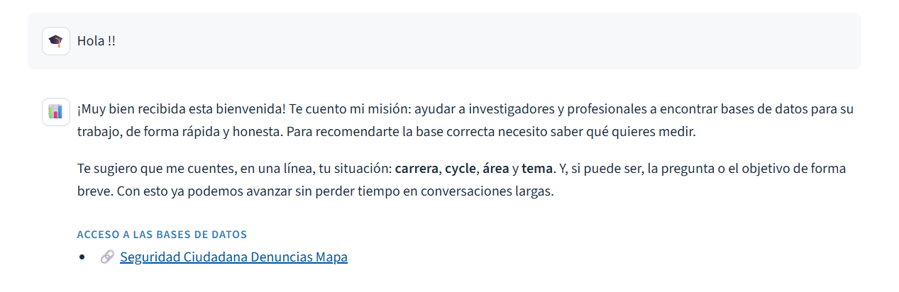

# Kalish Manta Analytics

**A RAG chatbot with a QLoRA fine-tuned LLM that connects researchers with the right Peruvian economics and social science datasets, running fully on a single laptop.**

You describe your research idea (an abstract, a hypothesis, or a professional project in economics). The assistant then recommends the matching datasets from a curated catalog, explains what each one contains (coverage, unit of analysis, key variables, join keys, caveats) and gives you a direct link to the processed data on Dropbox.

**Live demo:** https://laptop-bb3a7uht.tail80d628.ts.net/
*(The app is self-hosted, so it is available while the host laptop is online.)*


---

## Highlights

- **End-to-end GenAI system:** document parsing, chunking, embeddings, vector search, prompt construction, LLM fine-tuning, serving and a public web UI.
- **Fine-tuned Qwen3.5-4B with QLoRA (Unsloth)** on a consumer 8 GB GPU (RTX 5050 Laptop, Blackwell, CUDA 13). It loads in 4-bit NF4 and uses about 3.5 GB of VRAM at inference time.
- **Controlled experiments:** two rounds, with a single model load and LoRA weight resets between runs. Adding LoRA to every layer instead of attention only cut validation loss from **0.725 to 0.597**.
- **Found and fixed a hallucination and memorization problem** that came from a train/serve mismatch. The model is now trained on the exact production prompt, built by the real retriever.
- **Automated validation of synthetic training data:** 300 new conversations, each checked for retrieval, grounding, absence of links and token length. Result: **0 links and 0 facts outside the retrieved context**.
- **Data-driven retrieval threshold:** valid research queries score 0.60 to 0.87 and greetings or off-topic messages score 0.25 to 0.47, so the threshold sits at 0.53. A relative margin then filters loosely related datasets.
- **Deterministic where it matters:** the LLM never writes URLs. The code appends the Dropbox links from PDF metadata, so a link can never be hallucinated or corrupted.
- **Fully local and private:** open-weight models, no paid APIs, no data sent to third parties. The app is exposed over HTTPS with Tailscale Funnel.

---

## The problem

Empirical research in the social sciences in Peru starts with a bottleneck: **finding usable data**. Public data exists, but it is:

- **Scattered** across institutions: INEI, ministries, observatories and satellite catalogs.
- **Poorly documented:** undocumented variables, coding changes across years, and caveats you only discover late.
- **Expensive to prepare:** downloading, cleaning, merging and validating can take weeks before any analysis starts.

Students are hit hardest: choosing the right dataset for a research question is often the first big obstacle.

**The solution** is a conversational assistant on top of datasets that are already processed and documented. It understands the research question, recommends the right sources, explains how to use them and gives direct access to the files.

---

## Architecture



The system has two offline pipelines that feed one online query flow.

| Step | Component | What happens | Code |
|---|---|---|---|
| 1 | User | Writes an abstract, hypothesis or research objective | `app.py` |
| 2 | Streamlit web app | Chat UI, retrieval sliders, dataset catalog; public HTTPS URL through Tailscale Funnel | `app.py` |
| 3 | ChatbotService | Per-session memory (last 10 messages) and JSONL interaction logging | `src/llm_service.py` |
| 4 | Query embedding | `qwen3-embedding:4b` on Ollama (CPU), with a task instruction prefix | `QWEN3Embeddings.embed_query` |
| 5 | FAISS search | Cosine similarity against every chunk; threshold 0.53 and margin 0.10 | `RAGService.search`, `preparar_prompt` |
| 6 | Augmentation | For each dataset (max 3): its summary card (chunk 0) plus its most similar chunk, deduplicated | `_group_by_database` |
| 7 | System prompt | Role, full catalog, rules, retrieved data cards and chat history | `construir_system_prompt` |
| 8 | Generation | Fine-tuned Qwen3.5-4B in non-thinking mode, 4-bit NF4 | `QwenFineTunedLLM.generate` |
| 9 | Answer + access | LLM answer, followed by the Dropbox links taken from metadata | `answer_question` |

If no chunk passes the threshold (greetings, off-topic questions), the model gets an empty context. It is trained to answer without links and to ask for the research context.

---

## Tech stack

| Layer | Technology | Role |
|---|---|---|
| LLM | **Qwen3.5-4B** (hybrid: 8 full-attention + 24 linear-attention layers) | Answer generation, fine-tuned for the assistant's behavior |
| Fine-tuning | **Unsloth**, **TRL** `SFTTrainer`, **PEFT** LoRA, **bitsandbytes** NF4 | QLoRA on an 8 GB GPU |
| Embeddings | **qwen3-embedding:4b** served by **Ollama** | 2560-dim, L2-normalized vectors |
| Orchestration | **LangChain** (`Document`, `RecursiveCharacterTextSplitter`, `FAISS`, `Embeddings` interface) | Indexing and retrieval |
| Vector store | **FAISS** `IndexFlatL2` | Exact similarity search, stored on disk |
| Document parsing | **pypdf** | Text, official title, Dropbox link from PDF annotations |
| UI / API | **Streamlit**; **FastAPI** + **Pydantic** (optional REST API) | Web app and integration endpoint |
| Deployment | **Tailscale Funnel** | Public HTTPS URL to the local machine |
| Hardware | NVIDIA RTX 5050 Laptop GPU, 8 GB, Blackwell (sm_120), CUDA 13, PyTorch 2.14 cu130 | Training and inference |

---

## Data

- **15 datasets across 8 topics**, mostly from public official and academic sources: INEI, MINEDU, MININTER, Ministerio Público, SENAMHI, MTC, RAISG, Proética/Ipsos and Google Earth Engine. Coverage runs from 1995 to 2025, depending on the dataset.
- **Processed and ready to use:** panels built, variables renamed and documented, files in Stata, SPSS, Excel, CSV or shapefile format.
- **Hosted on Dropbox.** Each dataset has its own folder with the data and a detailed PDF data card. This repository only contains the PDF data cards; the data files stay on Dropbox (`data/raw/**/data/` is git-ignored).

| Topic | Datasets |
|---|---|
| Education | School Census 2006 to 2023; SíseVe school violence reports 2014 to 2023 |
| Firms and productivity | Firm panel from the Annual Economic Survey (EEA) 2012 to 2020 |
| Poverty | District-level monetary poverty rate, 2013 and 2018 |
| Public safety | SIDPOL police reports up to March 2025; RENADESPLE detainee records |
| Politics and corruption | Proética National Corruption Survey 2025 |
| Remote sensing | Nighttime lights by district 1995 to 2013; elevation, precipitation, slope, temperature |
| Illicit economies | Illegal mining in the Amazon shapefile (RAISG) |
| Cartography, climate and infrastructure | Administrative boundaries 2007 and 2017; national border; road network 2018; El Niño |

**The PDF data card is the core of the RAG.** Every card follows the same structure: name, summary, quick facts (topic, unit, coverage, period, format, size, join key), keywords and synonyms, questions it helps answer, files and main variables, usage notes, and the Dropbox link. The keywords and the "questions it answers" section act as a hand-written semantic index that brings the user's vocabulary closer to the document's.

---

## RAG pipeline

**Indexing** (`notebooks/1.IndexingFAISS.ipynb`, `src/pdf_reader.py`, `src/rag_service.py`)

1. `PDFReader` extracts the text with pypdf and keeps accents, casing and punctuation. An earlier version normalized the text, which hurt both the embeddings and the answers.
2. The official title is parsed from the "Nombre de base de datos" line. The Dropbox URL is read from the PDF's `/Link` annotations, with a regex fallback, and stored as metadata. The "source and access" section and all URLs are then removed from the indexed text, so the LLM never sees a link it could copy.
3. Each card becomes a LangChain `Document` with this metadata: `source`, `dataset`, `title`, `category` and `dropbox_link`.
4. `RecursiveCharacterTextSplitter` (900 characters, 100 overlap, splitting by paragraph, then line, sentence and word) produces **75 chunks**. Each chunk gets a `chunk_id` that records its position inside its PDF.
5. `FAISS.from_documents` embeds every chunk through a custom `QWEN3Embeddings` class, which implements LangChain's `Embeddings` interface over Ollama. The index is saved to `data/vectorstore/`.

**Retrieval and augmentation** (on every query)

- **Asymmetric embeddings:** documents are embedded as-is. Queries get a task prefix (`Instruct: ... Query: ...`), as Qwen3-Embedding recommends. This clearly separates real research questions from greetings.
- **Score:** FAISS `IndexFlatL2` returns squared L2 distance. For unit vectors, `d² = 2 − 2·cos`, so the code uses `similarity = 1 − d²/2`, which is exactly the cosine similarity.
- **Selection rules:**
  - Rank all chunks; the index is small, so this avoids every top-k hit coming from a single PDF.
  - Keep chunks with a score ≥ 0.53.
  - Keep only chunks within 0.10 of the best score.
  - Keep at most 3 distinct datasets.
- **Context per dataset:** the summary card (chunk 0) is always included, plus the most similar chunk. Repeated text and chunk overlaps are removed, so every context token counts.
- **Embeddings run on CPU** (0.24 s per query), which leaves the whole GPU for the LLM. Sharing the 8 GB GPU made generation much slower.

**Generation**

- The prompt contains the system prompt (role, full catalog, 5 rules, retrieved cards), the chat history (without links) and the user message.
- The full catalog sits in every prompt, so the model always knows the official dataset names and does not invent them.
- Sampling settings: temperature 0.2, top-p 0.9, up to 1024 new tokens. The saved chat template is patched for non-thinking mode, so no `<think>` blocks are produced.
- A thread lock serializes GPU generation so the app can safely serve concurrent users.

---

## Fine-tuning (QLoRA with Unsloth)

`notebooks/2.Finetuning_LLM_QLora.ipynb`

The base model stays frozen in 4-bit NF4. Only low-rank adapters are trained:

```
output = W·x + (α / r) · B·A·x        W frozen (4-bit NF4), A and B trainable, B initialized to 0
```

| Setting | Value |
|---|---|
| Base model | `unsloth/Qwen3.5-4B` (4.57B parameters; the vision tower is not fine-tuned) |
| LoRA | r = 16, dropout 0.05 |
| Optimizer | AdamW 8-bit, linear schedule, learning rate 4e-4 |
| Batch | 1 per device + gradient accumulation (effective batch 8 or 16) |
| Sequence length | 2560 tokens |
| Precision / memory | bf16, Unsloth gradient checkpointing, chunked cross-entropy |
| Loss | Assistant turns only (`train_on_responses_only`) |
| Split | 80 / 10 / 10 → 453 train, 57 validation, 57 test conversations (seed 3407) |
| Peak VRAM | 4.8 GB (all-layer LoRA, 2,459-token sequence) |

### Experiments

The model is loaded **once**, because 8 GB cannot hold a fresh copy per experiment, and the memory from a deleted model is not always freed. LoRA adapters are inserted into every linear layer a single time. Before each run:

- the initial LoRA weights are restored;
- the adapters outside the configuration under test are frozen with `B = 0`, so they leave the output unchanged;
- `scaling = α / r` is set.

This makes every run mathematically equivalent to a fresh start.

**Round A: hyperparameters** (LoRA on attention only). Both configurations take the same number of optimizer steps (about 114).

| Config | Epochs | Effective batch | α (α/r) | Weight decay | Val loss | Time |
|---|---|---|---|---|---|---|
| A1 | 2 | 8 | 16 (1.0) | 0.01 | 0.880 | 36 min |
| **A2** | **4** | **16** | **32 (2.0)** | **0.1** | **0.725** | 67 min |

**Round B: where to place LoRA** (with A2's hyperparameters)

| Target modules | Trainable params | Val loss | Time |
|---|---|---|---|
| Attention only (`q,k,v,o` in the 8 full-attention layers) | 3,145,728 (0.07%) | 0.725 | 67 min |
| **All layers** (+ linear-attention `in_proj_qkv, in_proj_z, out_proj` in 24 layers + MLP in all 32) | **30,474,240 (0.67%)** | **0.597** | 82 min |

The winner was selected on validation loss and evaluated once on the held-out test set (test loss 1.240). The gap from validation is expected with a 57-conversation test set. It is also why the next step is a task-level evaluation set (see Roadmap). The adapters are then merged into 16-bit weights (`save_pretrained_merged`) and loaded in production with plain `transformers` + `bitsandbytes` (no Unsloth or PEFT at inference time).

---

## Lessons learned: fixing memorization and hallucinations

The first fine-tuned model sounded fluent but did not read its context. It returned links for a simple "Hello", brought up public-safety datasets for no reason and invented variable names and figures.

<p align="center"></p>

**Root cause analysis** of the original 267 training conversations:

| Finding | Value | Effect |
|---|---|---|
| Training answers containing links written by the assistant | 33% | The model learned to emit links on its own |
| Conversations that included the RAG context | 0 / 267 | **Train/serve mismatch:** it learned to answer from memory, not from retrieved data |
| Answers starting with the same greeting | 64 | Memorized surface patterns |
| Similarity score of "Hola !!" on the old index | ≈ 0.5 | Greetings passed the threshold and triggered links |

**Fixes**

1. **Production-identical training data.** `src/construir_dataset_rag.py` runs the *real* retriever on each training conversation and builds the exact production system prompt. Both scripts import the same prompt code, so training and serving cannot drift apart.
2. **300 new conversations grounded in the 15 PDF cards**, covering:
   - 146 dataset queries
   - 20 two-topic queries
   - 20 requests for datasets outside the catalog
   - 25 greetings and 30 off-topic messages
   - 16 catalog questions
   - 25 answers to "the card doesn't say"
   - 10 farewells and 8 two-turn dialogs
3. **Automated validation** of every conversation:
   - **Retrieval:** the expected datasets are retrieved (or none, for greetings).
   - **Grounding:** every number, acronym and variable identifier in the answer appears in the retrieved context, the catalog or the user message.
   - **No links:** the assistant never writes a URL.
   - **Length:** the conversation fits in 2560 tokens.
4. **Links removed from the model's responsibility:** they were stripped from the original data and are appended by code, only when there is retrieved context.
5. **Negative examples:** 123 conversations with an empty context teach the model when *not* to describe a dataset.
6. **Better retrieval:** original (non-normalized) text, a query instruction, the data-driven threshold and the relative margin.

Final dataset: **567 conversations** (267 cleaned originals + 300 new), with **0 assistant links and 0 facts outside the context** in the new data.

---

## Run it locally

**Requirements:** Windows or Linux, an NVIDIA GPU with 8 GB or more, Python 3.13, [Ollama](https://ollama.com) and, optionally, [Tailscale](https://tailscale.com) for public access.

```bash
# 1. Environment
python -m venv .venv && .venv\Scripts\activate          # Linux: source .venv/bin/activate
pip install torch --index-url https://download.pytorch.org/whl/cu130
pip install transformers bitsandbytes accelerate langchain-community langchain-classic \
            faiss-cpu ollama pypdf streamlit fastapi uvicorn python-dotenv tqdm
pip install unsloth trl peft datasets                    # only needed for fine-tuning

# 2. Embedding model
ollama pull qwen3-embedding:4b

# 3. Configuration: create src/.env (model path, chunking, retrieval threshold, etc.)

# 4. Build the FAISS index           -> notebooks/1.IndexingFAISS.ipynb
# 5. Build the training dataset      -> python -m src.construir_dataset_rag
# 6. Fine-tune and merge the model   -> notebooks/2.Finetuning_LLM_QLora.ipynb

# 7. Launch the web app (keep this terminal open)
streamlit run app.py

# 8. Optional: publish it with HTTPS (second terminal)
tailscale funnel --bg 8501
```

The merged model (about 9 GB) is not included in the repository. Step 6 generates it in `output/LLMfine-tuning/LLM_Qlora`.

---

## Repository structure

```
├── app.py                         Streamlit web app (chat, sliders, catalog tab)
├── src/
│   ├── config.py                  Central configuration loaded from src/.env
│   ├── pdf_reader.py              PDF parsing: text, title, category, Dropbox link
│   ├── rag_service.py             Embeddings, FAISS, retrieval, prompt, fine-tuned LLM
│   ├── llm_service.py             Chatbot service: session memory and JSONL logging
│   ├── construir_dataset_rag.py   Builds and validates the fine-tuning dataset
│   ├── main.py, models.py         Optional FastAPI REST API and Pydantic schemas
├── notebooks/
│   ├── 1.IndexingFAISS.ipynb      Indexing pipeline
│   └── 2.Finetuning_LLM_QLora.ipynb  QLoRA experiments, evaluation and merge
├── data/
│   ├── raw/datasets/              PDF data cards by topic (data files live on Dropbox)
│   ├── Finetuning/                Training conversations (source .md and final .jsonl)
│   └── vectorstore/               FAISS index
├── img/                           Architecture diagram and screenshots
└── Slides/                        Project presentation
```

---

## Roadmap

- **Evaluation set:** 20 to 30 real questions with their expected datasets, to measure retrieval (hit rate@k, MRR) and answer faithfulness (human review or an LLM judge).
- **Query rewriting** with the chat history, so follow-up questions retrieve the right cards.
- **Hybrid search** (BM25 + vectors) and a **reranker**, and measure whether they raise the hit rate.
- **Serving with vLLM** (continuous batching) on a dedicated GPU server for always-on availability and higher throughput.
- **More datasets:** add a new PDF card and re-index; the catalog updates automatically.

---

## Author

**Roberto Mendoza**, AI engineering and data science. GitHub: [@Robertopucp](https://github.com/Robertopucp)

Licensed under the [Apache 2.0 License](LICENSE).
